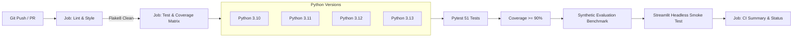

# ResumeAnalyzer

[](https://github.com/Amit-Shukla07/ResumeAnalyzer/actions/workflows/ci.yml)
[](https://www.python.org/)
[](https://pytest.org/)
[](https://flake8.pycqa.org/)

An explainable, Natural Language Processing (NLP) tool designed to help candidates and technical recruiters evaluate alignment between resumes and job descriptions (JDs).

---

## 📌 Project Overview

**ResumeAnalyzer** automates resume–JD screening assistance by comparing text similarity and technical skill alignment. It features:
- **In-Memory PDF Extraction**: Extracts multi-page text securely in RAM via PyMuPDF without writing files to disk.
- **Domain-Aware Preprocessing**: Preserves critical technical syntax (such as `C++`, `C#`, `.NET`, `Node.js`, and `REST APIs`) while normalizing formatting noise.
- **TF-IDF Vectorization**: Computes lexical and phrase cosine similarity across unigrams and bigrams with sublinear term-frequency scaling.
- **Deterministic Skill Extraction**: Uses a regular-expression dictionary to match 30+ technical skills without hallucination or substring false positives.
- **Explainable Heuristic Scoring**: Evaluates independent metrics for text similarity and skill match, combined through a documented, transparent weighted formula (20% TF-IDF / 80% Skill Match).
- **Interactive Streamlit UI**: A clean, modern dashboard with responsive dual-panel inputs, expandable text previews, and actionable resume tailoring advice.
- **Comprehensive CI/CD Pipeline**: Automated GitHub Actions testing across Python 3.10-3.13, flake8 code quality enforcement, and 96% test coverage guarantee.

---

## 🛠️ Technology Stack

- **Language**: Python 3.10+ (tested on Python 3.10, 3.11, 3.12, 3.13, 3.14)
- **PDF Engine**: PyMuPDF (`pymupdf` 2.0+)
- **NLP & Vectorization**: Scikit-learn (`scikit-learn` 1.9+)
- **Frontend Dashboard**: Streamlit (`streamlit` 1.66+)
- **Data & Numerical Processing**: NumPy & Pandas
- **Testing & Quality Assurance**: Pytest (`pytest`), Pytest-Cov (`pytest-cov`), Flake8 (`flake8`), Streamlit `AppTest`
- **Continuous Integration**: GitHub Actions CI workflow

---

## 📁 Project Structure

```text
ResumeAnalyzer/
├── .github/
│   └── workflows/
│       └── ci.yml             # GitHub Actions automated CI pipeline
├── app.py                     # Streamlit dashboard interface
├── requirements.txt           # Production dependencies
├── requirements-dev.txt       # Testing, coverage & linting dependencies
├── pytest.ini                 # Pytest test runner configuration
├── .flake8                    # Flake8 linting rules & line length configuration
├── README.md                  # Complete architecture & usage documentation
├── .gitignore                 # Version control exclusions & privacy guards
├── .streamlit/
│   └── config.toml            # Streamlit theme & server configuration
├── src/
│   ├── __init__.py            # Package exports
│   ├── pdf_extractor.py       # In-memory PDF text extraction & validation
│   ├── preprocessing.py       # Noise removal, lowercasing & tech token preservation
│   ├── matcher.py             # TF-IDF unigram/bigram cosine similarity engine
│   ├── skill_analyzer.py      # Dictionary-based skill detection & gap analysis
│   └── scoring.py             # Independent & combined heuristic scoring engine
├── tests/
│   ├── __init__.py            # Test package marker
│   ├── test_pdf_extractor.py  # In-memory synthetic PDF extraction tests
│   ├── test_preprocessing.py  # Text normalization & tech term preservation tests
│   ├── test_matcher.py        # TF-IDF similarity, NaN guards, & bounds tests
│   ├── test_skill_analyzer.py # Boundary, substring, and case-insensitivity tests
│   ├── test_scoring.py        # Score bounds, weights, & unavailable score tests
│   └── test_app_integration.py# Streamlit AppTest lifecycle & integration tests
└── evaluation/
    └── evaluate.py            # Reproducible synthetic benchmark script
```

---

## 🚀 Installation & Setup (macOS)

### 1. Prerequisites
Ensure Python 3.10 or higher is installed:
```bash
python3 --version
```

### 2. Create a Project-Specific Virtual Environment
From the project root:
```bash
python3 -m venv .venv
```
*(Alternatively, with `uv`: `uv venv .venv`)*

### 3. Activate the Virtual Environment
On macOS (`zsh` or `bash`):
```bash
source .venv/bin/activate
```

### 4. Install Dependencies
```bash
pip install -r requirements.txt
```
*(Alternatively, with `uv`: `uv pip install -r requirements.txt`)*

---

## 💻 Running the Application

Launch the Streamlit web dashboard:
```bash
streamlit run app.py
```
*(Or via direct binary: `.venv/bin/streamlit run app.py`)*

Open your browser to: **`http://localhost:8501`**

---

## 🧪 Testing, Coverage & Code Quality

### 1. Running the Pytest Suite
Execute all 51 automated unit, integration, and UI tests:
```bash
pytest
```
*(Or explicitly via virtual environment: `.venv/bin/python -m pytest -v`)*

To run specific test modules:
```bash
pytest tests/test_pdf_extractor.py -v   # PDF extraction tests
pytest tests/test_preprocessing.py -v   # Text normalization tests
pytest tests/test_matcher.py -v         # TF-IDF similarity tests
pytest tests/test_skill_analyzer.py -v  # Skill extraction & gap tests
pytest tests/test_scoring.py -v         # Scoring formula & weight tests
pytest tests/test_app_integration.py -v # Streamlit AppTest UI integration
```

### 2. Code Coverage Report
Generate full terminal and XML coverage metrics across all application code:
```bash
pytest --cov=src --cov-report=term-missing --cov-report=xml --cov-fail-under=90
```

**Current Coverage Benchmark (96% Total):**
| Module | Statements | Missing Lines | Coverage |
| :--- | :---: | :---: | :---: |
| `src/__init__.py` | 6 | 0 | **100%** |
| `src/preprocessing.py` | 24 | 0 | **100%** |
| `src/scoring.py` | 35 | 0 | **100%** |
| `src/pdf_extractor.py` | 38 | 1 | **97%** |
| `src/skill_analyzer.py` | 31 | 2 | **94%** |
| `src/matcher.py` | 29 | 3 | **90%** |
| **Total Engine Core** | **163** | **6** | **96%** |

### 3. Code Style & Linting
Run `flake8` across source modules, test suites, and evaluation scripts:
```bash
flake8 src tests evaluation
```
Configured via [.flake8](file:///Users/amitshukla/Desktop/ResumeAnalyzer/.flake8) with a 120-character line-length threshold and PEP 8 compliance rules.

---

## 🔄 Continuous Integration (CI) Pipeline

The repository includes a production-grade GitHub Actions workflow at [.github/workflows/ci.yml](file:///Users/amitshukla/Desktop/ResumeAnalyzer/.github/workflows/ci.yml) designed to run automatically on every push and pull request against `main`, `master`, and `develop`.



### Pipeline Jobs & Verification Stages:
1. **Lint & Code Style**:
   - Executes `flake8 src tests evaluation` to verify zero syntax errors, no unused imports, and consistent formatting.
2. **Multi-Version Test Matrix**:
   - Tests across Python `3.10`, `3.11`, `3.12`, and `3.13` in parallel on `ubuntu-latest`.
   - Utilizes `actions/setup-python@v5` with pip package caching.
3. **Automated Testing & Coverage Gate**:
   - Runs `pytest` with `--cov-fail-under=90`. Any PR lowering coverage below 90% automatically fails the build.
   - Generates and uploads `coverage.xml` build artifacts.
4. **Synthetic Property Evaluation**:
   - Runs [evaluation/evaluate.py](file:///Users/amitshukla/Desktop/ResumeAnalyzer/evaluation/evaluate.py) to guarantee relational consistency (similarity ordering and missing JD skill safety).
5. **Streamlit UI Smoke Test**:
   - Validates headless execution and module importing in a clean CI environment (`STREAMLIT_SERVER_HEADLESS=true`).
6. **Pipeline Summary**:
   - Compiles a GitHub Step Summary markdown table directly in the GitHub Actions UI.

---

## 📊 Running the Synthetic Evaluation Benchmark

Run the reproducible evaluation script over four benchmark scenarios:
```bash
python evaluation/evaluate.py
```

---

## 📐 Matching Methodology & Scoring Formula

### 1. Text Similarity (Lexical & Phrasing Overlap)
Measures the cosine similarity between TF-IDF document vectors fitted across unigrams and bigrams:
$$\text{text\_similarity} = \text{clip}\left(\cos(\mathbf{v}_{\text{resume}}, \mathbf{v}_{\text{jd}}) \times 100, 0.0, 100.0\right)$$
- `sublinear_tf=True` dampens repeated keyword stuffing.
- Custom token pattern (`r"(?u)\S+"`) ensures preprocessed technical terms (e.g., `c++`, `c#`, `.net`, `node.js`) remain intact unigrams.

### 2. Skill Match (Competency Coverage)
Calculates the proportion of recognized skills required by the job description that appear in the resume:
$$\text{skill\_match} = \frac{|\text{matched recognized skills}|}{|\text{total recognized required skills}|} \times 100$$
- **Unavailable Metric Rule**: If the job description does not contain any skills from the dictionary ($|\text{required\_skills}| = 0$), `skill_match` is marked as **Unavailable (`None`)** rather than returning 0%, preventing false penalties.

### 3. Combined Heuristic Score
Combines text similarity and skill match using configurable weights:
$$\text{combined\_score} = (w_{\text{text}} \times \text{text\_similarity}) + (w_{\text{skill}} \times \text{skill\_match})$$
- Default weights: $w_{\text{text}} = 0.20$, $w_{\text{skill}} = 0.80$ (defined in `src/scoring.py`).
- **Missing Value Handling**: If `skill_match` is unavailable, `combined_score` evaluates to `None` to ensure candidates are not penalized for missing JD keywords.

> [!IMPORTANT]
> **What These Metrics Mean**:
> - **Text Similarity** measures general vocabulary alignment and phrase overlap.
> - **Skill Match** indicates recognized keyword presence from a specific technical dictionary.
> - **Combined Score** is an illustrative heuristic score for initial screening assistance.
> - **None of these metrics represent candidate competence, job qualification, or the probability of being hired.**

---

## 📋 Example Output

Given:
- **Resume**: *"Senior backend developer experienced in Python, PostgreSQL, Docker, Git, and Linux."*
- **Job Description**: *"Looking for a software engineer proficient in Python, Docker, Git, and AWS."*

**Output Dictionary:**
```json
{
  "text_similarity": 22.47,
  "skill_match": 75.0,
  "combined_score": 64.49,
  "resume_skills": ["Docker", "Git", "Linux", "PostgreSQL", "Python"],
  "required_skills": ["AWS", "Docker", "Git", "Python"],
  "matched_skills": ["Docker", "Git", "Python"],
  "missing_skills": ["AWS"]
}
```

---

## 🔒 Privacy Considerations

- **Strictly In-Memory Processing**: Uploaded PDF files are read as binary streams in RAM and never saved to disk.
- **No External Network Calls**: All NLP extraction, tokenization, and scoring are executed locally on CPU. No third-party APIs or LLM endpoints receive your resume data.
- **Git Protections**: `.gitignore` explicitly prevents `.pdf`, `.docx`, `.env`, and upload artifacts from entering version control.

---

## ⚠️ Known Limitations

1. **Dictionary-Based Skill Extraction**: Only skills included in the 30-item dictionary are detected. Skills not in the dictionary (e.g., `Kubernetes`, `Rust`, `Django`, `GCP`) are not extracted in the skill breakdown (though they still contribute to TF-IDF text similarity).
2. **Scanned Images**: PDFs created as image-only scans without selectable text layers cannot be extracted without an OCR preprocessing engine.
3. **Semantic Paraphrasing**: TF-IDF cosine similarity measures lexical and n-gram overlap; it does not capture semantic equivalence between synonyms (e.g. "managed database replication" vs "handled data redundancy").

---

## 🔮 Future Improvements

- [ ] Support for editable custom skill dictionaries in the UI.
- [ ] Integration of optical character recognition (OCR) via Tesseract for scanned PDF resumes.
- [ ] Dense semantic embeddings (e.g. Sentence-Transformers) for conceptual similarity matching.
- [ ] Exportable analysis reports (JSON / PDF download).
